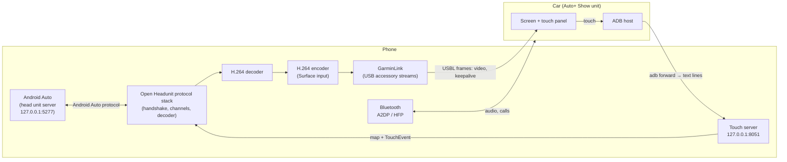

# AutoReplacer

Android Auto on a car screen that only speaks **Auto+ Show** (Garmin USB Link).

AutoReplacer runs Android Auto on your phone, encodes the picture, and sends it to the car over USB. The car's touches come back to the phone, so you can use Android Auto on the car's own screen. Audio and calls go over Bluetooth.

It is a **hard fork of [Open Headunit](https://github.com/andreknieriem/open-headunit)** (itself a continuation of Michael A. Reid's [Headunit](https://github.com/mikereidis/headunit)), reworked for one job: being the phone side of an Auto+ Show head unit. It is licensed under the **GNU AGPL v3**.

> **Status: working prototype, tested on one car and one phone.** Taiwan Toyota Corolla Cross with an Auto+ Show unit, Samsung SM-S9480 on Android 16, Android Auto 17.9. Expect rough edges. Please read [Limitations](#limitations) before relying on it.
>
> **Not affiliated** with Garmin, Google, Toyota or Auto+ Show. No Garmin code or assets are included; the USB protocol was worked out from observation (see [How this was found out](#how-this-was-found-out)).
>
> **Safety.** Android Auto is built to be used while driving with its own limits, but a touchscreen is still a distraction. Use voice control while the car is moving, and set up destinations before you drive. AutoReplacer does not try to override anything the car reports about driving restrictions.

## Contents

- [What it does](#what-it-does)
- [Requirements](#requirements)
- [Setting up and using it](#setting-up-and-using-it)
- [How it works](#how-it-works)
- [Debugging and logs](#debugging-and-logs)
- [How this was found out](#how-this-was-found-out)
- [Limitations](#limitations)
- [Building from source](#building-from-source)
- [Repository layout](#repository-layout)
- [Reporting a problem](#reporting-a-problem)
- [Licence and credits](#licence-and-credits)

## What it does

- **Shows Android Auto on the car.** Android Auto runs on the phone as if the phone were its own head unit. AutoReplacer decodes its H.264 picture, re-encodes it for the car, and sends it over USB.
- **Passes the car's touches to Android Auto.** Taps and drags work. Pinch does not: the car sends one finger.
- **Calibrates touch.** The car reports touch in a coordinate space that does not match its picture. A guided calibration (nine crosses on the car screen) measures the mapping and corrects it.
- **Pairs the car's Bluetooth** for audio and calls, and shows whether it is connected.
- **Recovers from USB drops.** It keeps its state, shows a waiting picture on the car, and reconnects Android Auto when the cable comes back.
- **Says what is happening.** One notification and a status card report the car link, Android Auto, touch and Bluetooth in plain words.
- **Keeps its own log.** Every important event is written to an app-owned file that is attached when you save a log.

It does **not** use root, Shizuku or accessibility services, and it does not record your screen.

## Requirements

- A car with an **Auto+ Show / Garmin USB Link** head unit (the unit shows "Auto+ Show" and is normally driven by Garmin's Auto+ Show phone app).
- An Android phone with **Android Auto** installed. Tested with Android Auto 17.9 on Android 16. The method relies on Android Auto's "head unit server" (Android Auto 17.4 or newer).
- **Developer options** and **USB debugging** turned on. The car's unit uses an ADB connection to set up its touch helper (see [Touch](#touch)).
- A USB data cable (not charge-only) and the car's USB port that works with Auto+ Show.
- Bluetooth, paired with the car, for audio and calls.
- Notifications allowed, so the status notification can show.

## Setting up and using it

1. **Install** the APK. The package is `com.andrerinas.headunitrevived.autoreplacer`, so it can sit next to Open Headunit. Debug builds are signed with a debug key, so installing over a build signed with another key needs an uninstall first.
2. **Open the app once** and go through the short setup. It checks Android Auto, Developer options, USB debugging and notifications, and asks for Bluetooth ("Nearby devices") permission.
3. **Turn on Android Auto's developer mode.** In Android Auto's settings, tap the version number about ten times. Then open *Developer settings*.
4. **Start the head unit server.** In Android Auto's *Developer settings*, open the menu and choose **Start head unit server**. Do this *before* plugging in. Android Auto may stop it after a session, so you may need to start it again (see [Limitations](#limitations)). The app warns you with an amber card if nothing is listening, and has an **Open Android Auto** button.
5. **Plug in.** Connect the phone to the car's Auto+ Show port. The first time, Android asks which app should handle the USB accessory: choose AutoReplacer and tick "Use by default".
6. **Allow the car's ADB prompt** on the phone if it appears (tick "Always allow" if you accept that this car can run ADB commands on the phone; see the [security notes](#security-notes)).
7. A **waiting picture** (a spinner and the current step) appears on the car, then Android Auto.
8. **Calibrate touch once.** With Android Auto showing, open the ⋮ menu on the home card, or *Settings → Car touch*, and choose *Calibrate touch on car*. Tap the middle of the nine crosses.

### The home screen

The home card shows the car session's state (waiting for the car, connecting, Android Auto starting, showing on the car, car disconnected), plus one line each for **Touch** and **Bluetooth**. **Reconnect** appears when the cable is in and no session is running. **⋮** holds *Save log* and *Calibrate touch on car*. The notification shows the same status and a *Save log* button.

## How it works



Four paths run at once: **Android Auto**, **video to the car**, **touch back from the car**, and **Bluetooth**.

### Android Auto on the phone ("self mode")

Open Headunit has a "self mode" where the phone acts as its own head unit. From Android Auto 17.4, Android Auto offers a *head unit server* (a developer feature) on `127.0.0.1:5277`. AutoReplacer connects to it, does the Android Auto handshake (protocol version 1.7, then TLS), announces a 1280×720 landscape screen (the car's size, not the phone's), and starts the message loop.

Things AutoReplacer does here that stock Open Headunit does not:

- It starts the **message loop itself** once the handshake completes. Open Headunit normally waits for its projection screen to do this; with no screen, Android Auto sent no video.
- It tells Android Auto to draw for the **car's landscape canvas** (`HeadUnitScreenConfig.carCanvas`), not the phone's portrait one.
- It keeps Open Headunit's **projection screen from opening** while a car session runs, so the decoder's output is not taken away from the car encoder.
- After Android Auto's session ends (it ends itself whenever the USB state changes), it **retries the connection** and shows what to do if the server stays silent.

### Video to the car

```
Android Auto → AAP video channel → H.264 decoder → Surface = encoder input
            → H.264 baseline encoder (1280×720, key frame every second, repeat last frame after 250 ms)
            → "USBL" frames over the USB accessory streams → car
```

- The decoder renders straight into the **encoder's input Surface**, so no frames are copied by the app. The encoder repeats the last picture after 250 ms, so a static screen still produces a steady stream.
- **Waiting picture.** Until Android Auto's first frame arrives, a second encoder draws a spinner, the app name, the current step and a timer. A Surface takes only one kind of producer, so this has to be a separate encoder. The first Android Auto picture replaces it.
- **Encoder rebuild.** When Android Auto's session restarts, its video timestamps start again from zero. An encoder that has already seen later timestamps drops every new frame as "going backward in time" (the car stays black). So the app builds a **fresh encoder** and re-attaches the decoder each time Android Auto's session restarts.
- **Nothing is sent before the car is ready.** The car announces `VIDEO_READY` before it wants a picture. Video sent earlier made the car reset its USB link.

### The Garmin USB Link (observed protocol)

The phone is a USB *accessory*; the car is the USB host. Frames are big-endian: an 8-byte header (service u16, type u16, length i32) followed by the payload. The session starts with the four ASCII bytes `USBL`.

| Direction | Service/type | Meaning |
| --- | --- | --- |
| phone → car | 1/1 | Session request: width, height, dpi, 0, 1, 2, stage |
| phone → car | 1/2 | One H.264 buffer |
| phone → car | 1/3 | Device report: width, height, orientation (sent with the first buffer) |
| phone → car | 1/4 | Terminate |
| phone → car | 1/5 | Keepalive (once a second while video flows) |
| phone → car | 1/17 | Safety mask reply `(mask=0, allowed=1)`, only when the car reports no restriction and no motion |
| car → phone | 2/1 | `VIDEO_READY`: seven ints (width, height, dpi, encoding, version, version, ADB status), then the car's Bluetooth address as 17 ASCII characters at byte 44 |
| car → phone | 2/6 | Keepalive answer (in practice rarely sent) |
| car → phone | 2/8 | HID test (ignored) |
| car → phone | 2/9 | Safety state: restriction flag and speed |
| car → phone | 2/11 | ADB status |

The unit usually sends very little after the start; silence from the car is normal.

### Touch

This took the longest to understand; see [How this was found out](#how-this-was-found-out).

1. The **car** is the one that knows about touches. Its unit connects to the phone over **ADB** (using the phone's USB-debugging authorization), pushes a small helper called `usblinkts`, and runs it. The helper listens on **TCP 8051** and takes text lines from the car: `a=init sw=… sh=… cw=… ch=…` once, then `a=ts x=… y=… b=…` per touch (`b` is 0 down, 1 up, 2 move). It then tries to inject those touches into the phone through a hidden Android API, which **fails on Android 14 and newer**.
2. AutoReplacer **binds `127.0.0.1:8051` first**. The car's forwarded connection then reaches the app and not the helper, which cannot start. The app receives the car's raw coordinates directly and sends them to Android Auto as touch events. No injection, overlay or shell access is needed.
3. The port is **held for the life of the app process**, so a car helper started by a later plug-in cannot take it. If an old helper already holds the port, the app sends it one line it cannot parse (`a=ts x=exit y=exit b=exit`); the helper's loop ends on the resulting exception and exits.
4. **Mapping.** The car's touch coordinates do not match its picture. On the tested car the touch panel reports about 1.28 times the picture height with its origin about 107 px above the picture's first row (see the first calibration in [the field notes](docs/research/field-notes.md)). The calibration fits `measured = a × picture + b` on each axis from nine taps, saves it, and un-maps every touch with it. Until calibrated, the app uses an estimate from the largest coordinate it has seen.
5. **Single finger only.** Each line carries one point and no pointer id, so pinch zoom cannot work. Android Auto's own on-screen zoom buttons cover it.
6. **Safety state.** The car also reports a restriction flag and a speed in its own messages (2/9). The app replies "allowed" only when the car reports no restriction and no motion, as the original app does, and **ends the session if the car reports motion**. It never answers "allowed" for a restricted car.

### Bluetooth

The car's Bluetooth address comes in `VIDEO_READY`. The app checks whether the phone is paired with it (starting pairing if not), and watches the A2DP and headset connection state for that device. It then reports "Car audio connected (media and calls)" or what is missing. If the car's audio is paired but not connected, the app asks Android to connect it using a hidden call, as the original Auto+ Show app does; on the test phone the media (A2DP) request is accepted and the call (headset) request is refused (`MODIFY_PHONE_STATE`). The status stays current with live broadcasts and a timer.

### Reconnect behaviour

When the USB link drops, the app:

1. Logs the **last 48 messages** in both directions and the video traffic before the drop.
2. Keeps the session for **90 seconds**, saying why in plain words ("The USB connection to the car was lost (the cable was unplugged, or the car restarted its USB)").
3. Rebuilds the car encoder when Android Auto's session ends, and **retries Android Auto** after 3 s, then every 4.5 s.
4. Opens a **new link** when the cable returns. A link that was not yet ready is replaced at once; a stale waiting picture is replaced too.
5. Shows the **waiting picture** until Android Auto's picture arrives.

### Status, notification and settings

One foreground notification (shared by the car service and Open Headunit's own service) shows the step, the touch line and the Bluetooth line. Settings has a *Car touch* section with the calibration state, *Reset* (with confirmation) and *Restore previous calibration*. Open Headunit settings that do not apply to a USB car (wireless connection, key mapping, themes, launcher, and so on) are hidden by `AutoShowUi`; set `AutoShowUi.ENABLED = false` to bring them back.

### Security notes

- AutoReplacer needs the **car** to be able to run ADB commands on your phone. Authorizing a car's ADB key ("Always allow") lets that car run shell commands on the phone. Do not do it on a car you do not own or trust. Android expires "Always allow" keys after seven days of disuse.
- The app opens a TCP port on **127.0.0.1** only. It is not reachable from the network.
- Logs hold a masked Bluetooth address (last two bytes) and your phone model. Check a log before posting it.

## Debugging and logs

### Saving a log

- Open the **⋮** menu on the home card and choose *Save log*, or use the **Save log** button in the notification. The file goes to **Downloads** as `AutoReplacer-log-<date>.txt`.
- The log has two parts: the system log (`logcat`; only the last few minutes of a busy session fit) and an **event log** kept by the app (up to 1.5 MB, across sessions) that is appended at the end. The event log is the part to read first.

### Reading the event log

Lines are `MM-DD HH:MM:SS.mmm EVENT …`. The important ones:

| Line | What it tells you |
| --- | --- |
| `GARMIN_USB_OPEN`, `GARMIN_SESSION_REQUEST` | A link opened and the phone sent its session request |
| `GARMIN_VIDEO_READY: 1280x720 …` | The car is ready; the size it wants |
| `GARMIN_FIRST_VIDEO_BUFFER_SENT` | Video started. It must come **after** `VIDEO_READY` |
| `AUTOSHOW_PROJECTION` | The encoder and decoder were wired up |
| `AUTOSHOW_AA_HANDSHAKE_COMPLETE` | Android Auto answered and the handshake finished |
| `AUTOSHOW_FIRST_FRAME`, `AUTOSHOW_SPLASH_DONE` | Android Auto's first picture reached the encoder and replaced the waiting picture |
| `AUTOSHOW_STATS …` | Every 5 s at first, then every 30 s: `lastDecodedFrame`, `carFrames`, `aaPictureFrames`, `touchLines` |
| `AUTOSHOW_AA_RETRY attempt N` | Android Auto did not answer (or its session ended); the app will try again |
| `AUTOSHOW_ENCODER_REBUILT` | Android Auto's session restarted; a fresh encoder was built |
| `GARMIN_ERROR`, `GARMIN_DROP_CONTEXT`, `GARMIN_LAST_TRAFFIC` | The link failed, and what was happening just before |
| `AUTOSHOW_LINK_ENDED`, `AUTOSHOW_STANDBY`, `AUTOSHOW_RESUMED` | The reconnect flow |
| `PHONE_STATE USB_STATE …`, `ACTION_POWER_*`, `USB_ACCESSORY_DETACHED` | Whether the phone lost power or the accessory detached |
| `GARMIN_SAFETY_STATE restricted=… speed=…` | The car's own flag (see [Limitations](#limitations)) |
| `TS8051_LISTENING`, `TS8051_CONNECTED`, `TS8051_INIT`, `TS8051_CLOSED lines=… bytes=…` | The touch port and the car's connection to it |
| `TS8051_IDLE`, `TS8051_FIRST_BYTES` | Connected but silent, and the first raw bytes the car sent |
| `AUTOSHOW_TOUCH car=x,y → aa=x,y action=…` | One touch, before and after mapping |
| `AUTOSHOW_CALIBRATION_*`, `AUTOSHOW_TOUCH_AREA` | The calibration run and the mapping in use |
| `CAR_BLUETOOTH_*` | Pairing, audio connection and the hidden-connect attempts |

### Common situations

| You see | It usually means |
| --- | --- |
| Amber "Start Android Auto's server first" | Nothing is listening on `127.0.0.1:5277`. Start the head unit server in Android Auto's developer settings, then plug in. |
| `the peer accepted the connection and then sent nothing at all` | Android Auto's server accepted the connection but does not answer. After a session ended it can stay silent for a minute or more. Stop and start the head unit server. A connect-and-close probe also causes this, so the app never probes by connecting. |
| `TS8051_BIND_FAILED … EADDRINUSE` | An old car helper holds port 8051. The app asks it to exit; if it persists, restart the phone once. |
| `TS8051_CONNECTED` but no `TS8051_INIT` | The car connected to the touch port and sent nothing. See [Limitations](#limitations). |
| `GraphicBufferSource: Dropping frame that's going backward in time` | The encoder was kept across an Android Auto restart. The app now rebuilds it; if you still see this with a black car screen, send the log. |
| `GARMIN_FIRST_VIDEO_BUFFER_SENT` before `GARMIN_VIDEO_READY` | Video went to a link before the car was ready; the car usually resets its USB a few seconds later. Fixed, but shows what to look for. |
| `read failed: EIO`, `write failed: ENODEV`, `read interrupted by close()` | The USB accessory connection failed. Compare with the `PHONE_STATE` lines: a `POWER_DISCONNECTED` means the cable lost power; `USB_STATE … configured=false` without it means the car reset its USB function. |
| `Input stream already open for this accessory` | A new link opened the accessory before the old one released it. The app closes replaced links at once and retries. |

### Tests

Plain-Java checks for the protocol classes need no Android SDK:

```sh
sh openheadunit/autoshow-tests/run.sh
```

They cover framing and parsing (`Wire`, `TsProtocol`), the serial writer, the session watchdog, Bluetooth planning, touch mapping and calibration fitting, the touch server (including eviction of an old helper against a copy of the helper's loop), the port check and the plain-language disconnect messages.

## How this was found out

None of this protocol is documented. This section records how it was worked out, including the wrong turns, so you can judge how much to trust each claim. Detailed notes, with the evidence, are in [`docs/`](docs).

### The starting question

Video from a phone to an Auto+ Show unit worked in an early probe, but touching the car screen did nothing. The question was whether the touch could be obtained at all, and how.

### Step 1: a probe app

A small diagnostic app (`app/`, the "Rental Display Probe", kept for reference) implemented the USB link from observation, drew a numbered grid on both the phone and the car, and logged every input event with where it came from. Its test plans are in [`docs/research/probe-test-plans.md`](docs/research/probe-test-plans.md).

### Step 2: static analysis of the Auto+ Show app

Three releases of Garmin's own phone app (1.1.5.1, 1.3.4.1, 1.3.5.1) were downloaded from public app stores, signature-checked, and decompiled with `jadx`. The finding: **the phone app contains no touch code at all.** It checks whether USB debugging is on, asks the car (service 1, type 8) to set up ADB, and the car does the rest. The comparison is in [`docs/auto-show-decompile-1.3.5.1.md`](docs/auto-show-decompile-1.3.5.1.md) and [`docs/auto-show-version-comparison.md`](docs/auto-show-version-comparison.md).

### Step 3: where does touch arrive on the phone?

The candidate paths were checked against Android's source ([`docs/android-input-paths-aosp.md`](docs/android-input-paths-aosp.md)):

- **USB HID touchscreen.** The phone log showed the car registering an external touchscreen (vendor/product `ffff`) every session, but no events from it ever reached an app. Not the path.
- **ADB injection.** The car's ADB host pushing and running a helper. Promising.
- **Bluetooth.** Auto+ Show uses it for audio only (its code has no HID).

One wrong assumption here: the first plan used touch *pressure* to tell injected taps from real ones. On the test Samsung every real tap reports pressure 1.00 too, so size and touch-major were used instead.

### Step 4: capturing the car's ADB traffic

With the phone's own on-device ADB (LADB, running as the shell user), the car's commands showed up in `logcat`: it ran `getprop ro.build.version.sdk`, pushed `usblinkts` and `usblinkts_service` to `/data/local/tmp`, made them executable, and ran the service. The files were pulled and decompiled ([`docs/usblinkts-helper.md`](docs/usblinkts-helper.md)):

- The helper listens on **TCP 8051** and reads text lines (`a=init …`, `a=ts …`).
- It injects through the hidden `InputManager.getInstance()`, which on Android 14+ needs an `Application` that a bare `app_process` does not have. It throws a `NullPointerException` on every touch: **the car sends touches and the phone drops them**.

That explained the failure, and it also suggested the fix: **be the thing listening on 8051**.

### Step 5: binding port 8051

The probe bound `127.0.0.1:8051` before the car's helper started, so the car's forwarded connection reached the probe. In the **first** car run the car connected but sent no touch lines at all, the same as it had with its own helper. The decompiled Garmin app showed one more thing it does: it **answers every safety-state message from the car with a type-17 reply**. The probe never did. With a reply added (`mask=0, allowed=1`, sent only when the car reports no restriction and no motion), the car sent `a=init` and then `a=ts` lines, and all five grid targets were hit from the car screen. That was the first time car touch reached an app.

That run suggested that the car withholds touch until the phone answers its safety state. Later logs from AutoReplacer show touch also arriving in a few sessions without a fresh reply, so treat it as "this is what made it start working", not as an exact rule (see [Things we got wrong](#things-we-got-wrong-and-corrected)).

### Step 6: Android Auto on the phone

Open Headunit was chosen as the base because it already speaks the Android Auto protocol and has a loopback "self mode". The work was then to make it headless, aim it at a car screen, and feed it the car's video and touch. Field logs drove almost every fix:

| Symptom | Cause found in the log | Fix |
| --- | --- | --- |
| Blank car screen, link dropped after 15 s | `AapTransport.startReading` was never called without a projection screen | Start the message loop when the handshake completes |
| Android Auto drew a portrait canvas with margins | Geometry came from the phone's screen | `HeadUnitScreenConfig.carCanvas` |
| Home screen opened and closed the projection screen thousands of times a second | Two guards fighting over who owned the surface | Guard the home screen's raise as well |
| Android Auto "connected" but the handshake went unanswered | A connect-and-close **probe** of port 5277 (my own) used up the server's single accepted connection | Check by binding, never by connecting |
| After a reconnect the car stayed black although the decoder was rendering | `GraphicBufferSource: Dropping frame that's going backward in time` (timestamps restarted) | Rebuild the encoder when Android Auto's session restarts |
| Video sent before `VIDEO_READY` made the car reset its USB | Standby fed frames to a new link early | Drop buffers until the car is ready |
| A second reconnect showed a black screen | A stale waiting picture still sent to the old link | Always start a fresh one |

### Step 7: calibrating touch

Touches near the bottom row of Android Auto's screen only worked at the very top of each icon. A log showed taps in the bottom strip reporting y values of 740–795 on a 720-pixel picture, which the app was clamping. A guided calibration then recorded nine taps: `x measured = 1.034 × picture − 0.011`, `y measured = 1.276 × picture − 0.146`. Un-mapping with that fixed it.

### Things we got wrong and corrected

These are kept because they show the limits of reasoning from a few logs:

- **The "restricted" flag.** The car's safety message carries a restriction flag. Early on it seemed that touch only worked when the flag was 0 at session start, and a "Locked by the car" status was added. A later log showed touch working with the flag at 1 and unanswered, so the status was removed. The flag changes in the logs while the speed field is always 0, including while driving. The honest summary: touch sometimes arrives under `restricted=1` and sometimes does not, and nothing seen on the phone explains the difference. The app logs the flag and does not override the car.
- **A standby that kept Android Auto alive.** The idea was to keep Android Auto's session across a USB drop. The log showed Android Auto ends its own session about 4 ms after the USB state changes, so the standby only keeps the app waiting; the real recovery is rebuilding the encoder and reconnecting.
- **The cable.** Many drops are `EIO` on the accessory streams. One log showed the link dying 14 seconds before the phone saw power or the accessory leave, and turning the cable round fixed it for a long stretch. That points at the connection or the car's USB handling; the phone cannot tell which.

### Method

The same loop each time: save a log from a real car run, read the app's event log first, build a table of sessions (start time, car state, touch or not, how it ended) with a short script, form a hypothesis, check it against **every** log not just the latest, change one thing, and record the result in [`docs/research/field-notes.md`](docs/research/field-notes.md). When the logs could not decide something, the app was changed to log what was missing (the drop traffic recorder, the USB power state, the raw touch bytes).

### Where the evidence lives

| File | What it holds |
| --- | --- |
| [`docs/research/field-notes.md`](docs/research/field-notes.md) | Dated results from real car runs, newest last |
| [`docs/research/touch-investigation.md`](docs/research/touch-investigation.md), [`docs/research/log-analysis-2026-11-07.md`](docs/research/log-analysis-2026-11-07.md) | Early touch investigation and log reading |
| [`docs/auto-show-decompile-1.3.5.1.md`](docs/auto-show-decompile-1.3.5.1.md), [`docs/auto-show-version-comparison.md`](docs/auto-show-version-comparison.md) | What the Auto+ Show app does and does not do |
| [`docs/usblinkts-helper.md`](docs/usblinkts-helper.md) | The car's touch helper and why it fails on Android 14+ |
| [`docs/android-input-paths-aosp.md`](docs/android-input-paths-aosp.md) | How each touch path looks to an app, from AOSP source |
| [`docs/autoreplacer-on-openheadunit.md`](docs/autoreplacer-on-openheadunit.md), [`docs/android-auto-plan.md`](docs/android-auto-plan.md) | Why Open Headunit, and the plan |
| [`docs/research/probe-*.md`](docs/research) | The probe app's history, tests and validation |
| [`openheadunit/UPSTREAM.md`](openheadunit/UPSTREAM.md) | Every change made on top of the Open Headunit import |
| [`openheadunit/CHANGELOG-AUTOREPLACER.md`](openheadunit/CHANGELOG-AUTOREPLACER.md) | User-facing change history |

## Limitations

- **Tested on one car and one phone.** Other Auto+ Show cars, other phones and other Android versions are untested. The touch calibration is per phone, not per car.
- **Single-finger touch.** The car's touch link carries one point per line, so pinch and two-finger gestures cannot work.
- **Android Auto's head unit server must be started by hand** in its developer settings, and Android Auto may stop it after a session. AutoReplacer cannot start it for you. If it stays silent after a USB drop, stop and start it again.
- **A USB reset ends Android Auto's session.** Android Auto closes its own session when the USB state changes, so a drop always means a reconnect of Android Auto, not just of the cable.
- **Touch sometimes does not arrive** (the car connects to the touch port and sends nothing), and the cause is not known. The car's restriction flag does not explain it reliably. See [Things we got wrong](#things-we-got-wrong-and-corrected).
- **Intermittent USB drops** happen on the tested setup. A cable, port or car-side cause is likely; the app can only recover, not prevent them.
- **Bluetooth calls.** The phone cannot connect the headset (call) profile itself; if it is not connected, choose the car in the phone's Bluetooth settings.
- **No audio routing control.** Android Auto's audio goes where Android sends it; the app only checks the car's Bluetooth.
- **English only.** Strings for hidden Open Headunit features and the translations still use the old names.
- **Early software.** Debug-signed builds, no store release, no automatic updates.

## Building from source

Requirements: **JDK 17**, the **Android SDK** (platform 36, build-tools), network access for Gradle, and `ANDROID_HOME` set. The Gradle wrapper (8.14.4) is included.

```sh
cd openheadunit
./gradlew :app:assembleGithubDebug
# the APK is in app/build/outputs/apk/github/debug/
```

- The `github` flavour is the one AutoReplacer uses; it adds the `.autoreplacer` application ID suffix (`com.andrerinas.headunitrevived.autoreplacer`).
- Release signing is read from your own keystore properties; do not commit keys.
- Run the plain-Java checks with `sh openheadunit/autoshow-tests/run.sh`.
- Version names are AutoReplacer's own (`0.7.x`). Add a line to [`openheadunit/CHANGELOG-AUTOREPLACER.md`](openheadunit/CHANGELOG-AUTOREPLACER.md) with each release.

The earlier probe app is built with `build.py` at the repository root (see [`app/README.md`](app/README.md)).

**Releases.** Pushing a tag such as `v0.7.18` (it must match `versionName`) makes GitHub build the APK, run the checks and attach the APK to a pre-release. See [`RELEASING.md`](RELEASING.md) for the steps and for setting up a stable signing key.

## Repository layout

```
openheadunit/                    The AutoReplacer app (Open Headunit, reworked)
  app/src/main/java/.../autoshow/   Everything specific to the car:
      AutoShowService.kt            session orchestration, reconnect, calibration flow
      GarminLink.java, Wire.java    USB Link framing and the link state machine
      CarEncoder.java, CarSplash.java, CarCalibrationScreen.java   video to the car
      CarTouchServer.java, AutoShowTouchHub.kt, TsProtocol.java    touch on port 8051
      TouchArea.java, AutoShowTouchArea.kt                         touch mapping and calibration
      CarBluetooth.kt, BluetoothPlan.java                          Bluetooth
      AutoShowState.kt, AutoShowStatusCard.kt, AutoShowNotification.kt   status
      AutoShowUi.kt                 what is hidden from Open Headunit's screens
      AutoShowEventLog.kt, AutoShowLogSaver.kt                     logging
  autoshow-tests/               Plain-Java checks (no Android SDK)
  UPSTREAM.md                   Changes on top of the Open Headunit import
  CHANGELOG-AUTOREPLACER.md     User-facing changes
  README-OPEN-HEADUNIT.md       Open Headunit's own README, for reference
app/                            The earlier diagnostic probe (kept for reference)
docs/                           Research notes and findings
docs/research/                  Field notes and the probe's history
tests/, build.py                The probe's tests and build script
LICENSE                         GNU AGPL v3
```

## Reporting a problem

Open an issue with:

1. What you saw on the **car** and on the **phone**, and roughly when.
2. The **saved log** (*⋮ → Save log*, from Downloads). Look it over first: it has your phone model and a masked Bluetooth address.
3. The phone model, Android version, Android Auto version, and the car and unit.

For USB drops and missing touch, note what you did at the time (unplugged, turned the cable, started the car, began driving). Those timestamps are what lines the log up with real events.

## Licence and credits

- **AutoReplacer** is a **hard fork** of Open Headunit. It is not kept in sync with upstream, and it does not aim to be merged back. What changed is listed in [`openheadunit/UPSTREAM.md`](openheadunit/UPSTREAM.md); the import point is recorded there.
- It is released under the **GNU Affero General Public License v3** ([`LICENSE`](LICENSE)). Anyone who distributes a build, or lets people use a modified version over a network, must offer the complete corresponding source under the same licence.
- **Open Headunit**: André Rinas and contributors, <https://github.com/andreknieriem/open-headunit>.
- **Headunit**: Michael A. Reid, <https://github.com/mikereidis/headunit>, the original Android Auto head unit code and protocol work (notice: [`openheadunit/COPYRIGHT_MICHAEL_REID_GPLv3AFFERO.txt`](openheadunit/COPYRIGHT_MICHAEL_REID_GPLv3AFFERO.txt)).
- Third-party libraries keep their own licences (see the app's dependency list).
- "Garmin", "Auto+ Show", "Android Auto", "Toyota" and other names belong to their owners and are used only to say what the software works with. The USB protocol described here was worked out from observing a car and from public analysis of freely downloadable apps, for interoperability.
