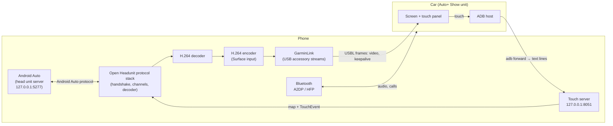

# How AutoReplacer works

How the phone, Android Auto and the car fit together. For setup and use, see the [README](../README.md); for the research behind it, see [How this was found out](how-it-was-found.md).



Four paths run at once: **Android Auto**, **video to the car**, **touch back from the car**, and **Bluetooth**.

## Android Auto on the phone ("self mode")

Open Headunit has a "self mode" where the phone acts as its own head unit. From Android Auto 17.4, Android Auto offers a *head unit server* (a developer feature) on `127.0.0.1:5277`. AutoReplacer connects to it, does the Android Auto handshake (protocol version 1.7, then TLS), announces a 1280×720 landscape screen (the car's size, not the phone's), and starts the message loop.

Things AutoReplacer does here that stock Open Headunit does not:

- It starts the **message loop itself** once the handshake completes. Open Headunit normally waits for its projection screen to do this; with no screen, Android Auto sent no video.
- It tells Android Auto to draw for the **car's landscape canvas** (`HeadUnitScreenConfig.carCanvas`), not the phone's portrait one.
- It keeps Open Headunit's **projection screen from opening** while a car session runs, so the decoder's output is not taken away from the car encoder.
- After Android Auto's session ends (it ends itself whenever the USB state changes), it **retries the connection** and shows what to do if the server stays silent.

## Video to the car

```
Android Auto → AAP video channel → H.264 decoder → Surface = encoder input
            → H.264 baseline encoder (1280×720, key frame every second, repeat last frame after 250 ms)
            → "USBL" frames over the USB accessory streams → car
```

- The decoder renders straight into the **encoder's input Surface**, so no frames are copied by the app. The encoder repeats the last picture after 250 ms, so a static screen still produces a steady stream.
- **Waiting picture.** Until Android Auto's first frame arrives, a second encoder draws a spinner, the app name, the current step and a timer. A Surface takes only one kind of producer, so this has to be a separate encoder. The first Android Auto picture replaces it.
- **Encoder rebuild.** When Android Auto's session restarts, its video timestamps start again from zero. An encoder that has already seen later timestamps drops every new frame as "going backward in time" (the car stays black). So the app builds a **fresh encoder** and re-attaches the decoder each time Android Auto's session restarts.
- **Nothing is sent before the car is ready.** The car announces `VIDEO_READY` before it wants a picture. Video sent earlier made the car reset its USB link.

## The Garmin USB Link (observed protocol)

The phone is a USB *accessory*; the car is the USB host. Frames are big-endian: an 8-byte header (service u16, type u16, length i32) followed by the payload. The session starts with the four ASCII bytes `USBL`.

| Direction | Service/type | Meaning |
| --- | --- | --- |
| phone → car | 1/1 | Session request: width, height, dpi, 0, 1, 2, stage |
| phone → car | 1/2 | One H.264 buffer |
| phone → car | 1/3 | Device report: width, height, orientation (sent with the first buffer) |
| phone → car | 1/4 | Terminate |
| phone → car | 1/5 | Keepalive (once a second while video flows) |
| phone → car | 1/17 | Safety mask reply `(mask=0, allowed=1)`, only when the car reports no restriction and no motion |
| car → phone | 2/1 | `VIDEO_READY`: seven ints (width, height, dpi, encoding, version, version, ADB status), then the car's Bluetooth address as 17 ASCII characters at byte 44 |
| car → phone | 2/6 | Keepalive answer (in practice rarely sent) |
| car → phone | 2/8 | HID test (ignored) |
| car → phone | 2/9 | Safety state: restriction flag and speed |
| car → phone | 2/11 | ADB status |

The unit usually sends very little after the start; silence from the car is normal.

## Touch

This took the longest to understand; see [How this was found out](how-it-was-found.md).

1. The **car** is the one that knows about touches. Its unit connects to the phone over **ADB** (using the phone's USB-debugging authorization), pushes a small helper called `usblinkts`, and runs it. The helper listens on **TCP 8051** and takes text lines from the car: `a=init sw=… sh=… cw=… ch=…` once, then `a=ts x=… y=… b=…` per touch (`b` is 0 down, 1 up, 2 move). It then tries to inject those touches into the phone through a hidden Android API, which **fails on Android 14 and newer**.
2. AutoReplacer **binds `127.0.0.1:8051` first**. The car's forwarded connection then reaches the app and not the helper, which cannot start. The app receives the car's raw coordinates directly and sends them to Android Auto as touch events. No injection, overlay or shell access is needed.
3. The port is **held for the life of the app process**, so a car helper started by a later plug-in cannot take it. If an old helper already holds the port, the app sends it one line it cannot parse (`a=ts x=exit y=exit b=exit`); the helper's loop ends on the resulting exception and exits.
4. **Mapping.** The car's touch coordinates do not match its picture. On the tested car the touch panel reports about 1.28 times the picture height with its origin about 107 px above the picture's first row (see the first calibration in [the field notes](research/field-notes.md)). The calibration fits `measured = a × picture + b` on each axis from nine taps, saves it, and un-maps every touch with it. Until calibrated, the app uses an estimate from the largest coordinate it has seen.
5. **Single finger only.** Each line carries one point and no pointer id, so pinch zoom cannot work. Android Auto's own on-screen zoom buttons cover it.
6. **Safety state.** The car also reports a restriction flag and a speed in its own messages (2/9). The app replies "allowed" only when the car reports no restriction and no motion, as the original app does, and **ends the session if the car reports motion**. It never answers "allowed" for a restricted car.

## Bluetooth

The car's Bluetooth address comes in `VIDEO_READY`. The app checks whether the phone is paired with it (starting pairing if not), and watches the A2DP and headset connection state for that device. It then reports "Car audio connected (media and calls)" or what is missing. If the car's audio is paired but not connected, the app asks Android to connect it using a hidden call, as the original Auto+ Show app does; on the test phone the media (A2DP) request is accepted and the call (headset) request is refused (`MODIFY_PHONE_STATE`). The status stays current with live broadcasts and a timer.

## Reconnect behaviour

When the USB link drops, the app:

1. Logs the **last 48 messages** in both directions and the video traffic before the drop.
2. Keeps the session for **90 seconds**, saying why in plain words ("The USB connection to the car was lost (the cable was unplugged, or the car restarted its USB)").
3. Rebuilds the car encoder when Android Auto's session ends, and **retries Android Auto** after 3 s, then every 4.5 s.
4. Opens a **new link** when the cable returns. A link that was not yet ready is replaced at once; a stale waiting picture is replaced too.
5. Shows the **waiting picture** until Android Auto's picture arrives.

## Status, notification and settings

One foreground notification (shared by the car service and Open Headunit's own service) shows the step, the touch line and the Bluetooth line. Settings has a *Car touch* section with the calibration state, *Reset* (with confirmation) and *Restore previous calibration*. Open Headunit settings that do not apply to a USB car (wireless connection, key mapping, themes, launcher, and so on) are hidden by `AutoShowUi`; set `AutoShowUi.ENABLED = false` to bring them back.

## Security notes

- AutoReplacer needs the **car** to be able to run ADB commands on your phone. Authorizing a car's ADB key ("Always allow") lets that car run shell commands on the phone. Do not do it on a car you do not own or trust. Android expires "Always allow" keys after seven days of disuse.
- The app opens a TCP port on **127.0.0.1** only. It is not reachable from the network.
- Logs hold a masked Bluetooth address (last two bytes) and your phone model. Check a log before posting it.
